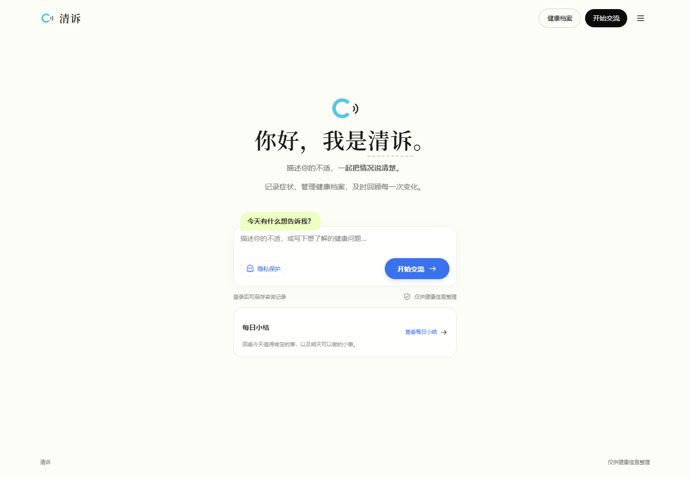
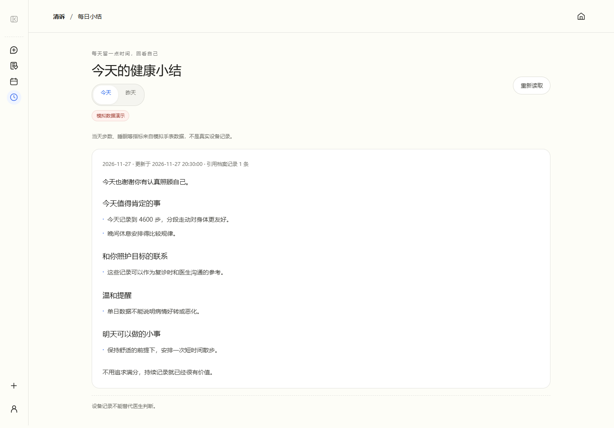
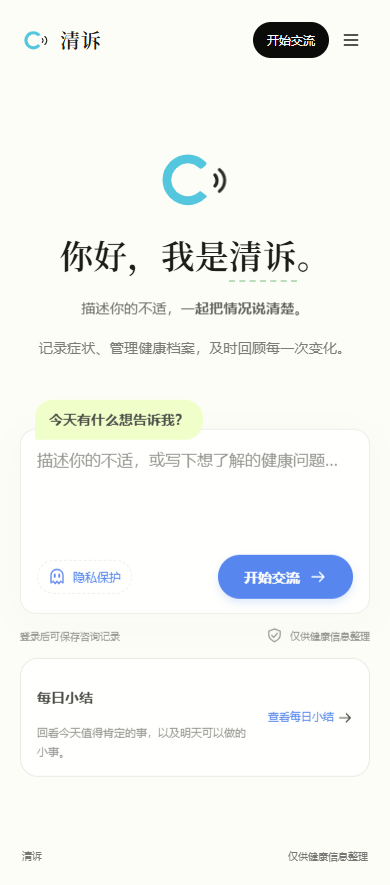

# 每日小结入口与历史浏览

关联 Issue：#41

## 背景

每日小结此前只有工作区侧边栏、移动端底部导航和 landing 汉堡菜单三个入口。用户必须先知道日报存在，才会主动进入菜单查找；完成问诊后也没有直接查看当天小结的衔接。

日报页面此前固定读取当天报告，虽然 `GET /api/daily?date=` 已支持历史日期，但界面无法查看昨天。

## 本次改动

### 首页入口

- 在 landing 输入框下方增加紧凑的「每日小结」卡片；
- 卡片沿用现有边框、圆角、字体与蓝色强调色，不改动现有视觉体系；
- 点击后进入 `/pages/daily/index`；
- 卡片本身不请求日报接口，避免 landing 首次加载增加额外依赖。

### 问诊后衔接

- 问诊结果自动归档后，在聊天输入框上方显示「查看今日小结」；
- 普通问诊完成后显示；
- 随访流程不显示该入口，避免与随访提交混淆。

### 历史浏览

- 每日小结页增加「今天 / 昨天」切换；
- 两个日期都复用现有 `GET /api/daily?date=`；
- 今天没有报告时仍可点击「生成今日小结」；
- 昨天没有报告时只展示历史空状态，不提供补生成入口，避免把“查看历史”误解为“补写历史”；
- 日期切换时清理上一日期的正文，并通过请求版本号丢弃迟到响应；
- 切换失败、记录不足、待人工核实和输入未通过检查时，继续使用既有本地文案。

## 文案与可用性

- 用户界面不再展示内部 `workflow_version`；
- 「由后端合成」改为「来自模拟手表数据」；
- 移除页面中重复的「清诉 · 每日小结」标题，改为更轻的说明文案；
- 「今天 / 昨天」按钮高度调整为至少 44px；
- 手机端「查看今日小结」按钮高度调整为至少 44px；
- 问诊完成提示和日报入口允许换行，避免窄屏挤压。

## 接口边界

本次没有新增或修改后端接口：

- 读取当天或历史报告：`GET /api/daily?date=YYYY-MM-DD`
- 生成当天报告：`POST /api/daily/generate`

前端仍然只访问清诉自己的 `/api`，不接触 AgentArts Key、平台事件或内部工作流版本。

## 不在本次范围

- 红点、未读状态和主动推送；
- 7 天列表或日历选择；
- 定时生成；
- 真实手表数据适配；
- 后端、数据库和 AgentArts 工作流修改。

## 验证

已执行：

```bash
pnpm type-check
pnpm check:interactions
pnpm build:h5
pnpm build:mp-weixin
git diff --check
```

交互检查覆盖：

- 今天与昨天分别请求对应日期；
- 昨天缺失时不提供「生成今日小结」；
- 日报业务码与现有空状态映射不退化为通用错误；
- 退出登录后迟到响应不恢复上一账户内容。

## 预览







## 相关文件

- `frontend/src/components/QWorkspace.vue`
- `frontend/src/components/QDailyReport.vue`
- `frontend/scripts/check-interactions.mjs`
- `docs/FRONTEND_WORKSPACE.md`
