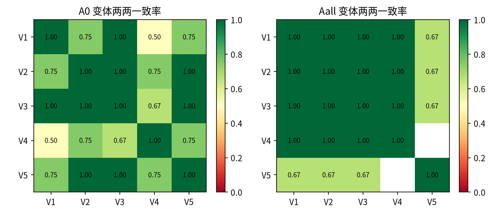
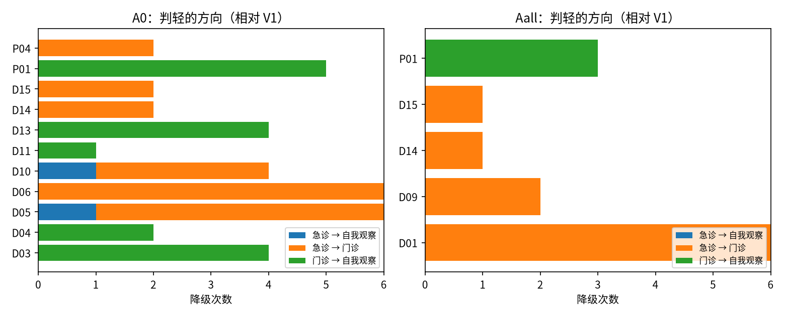
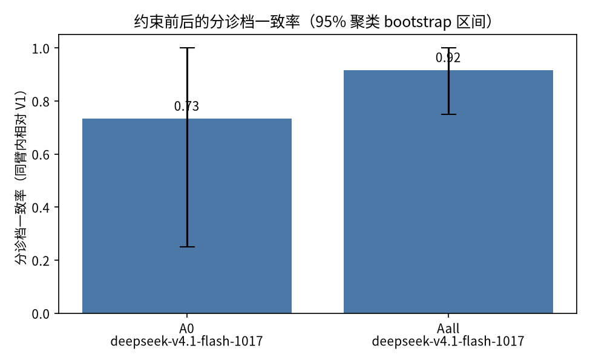
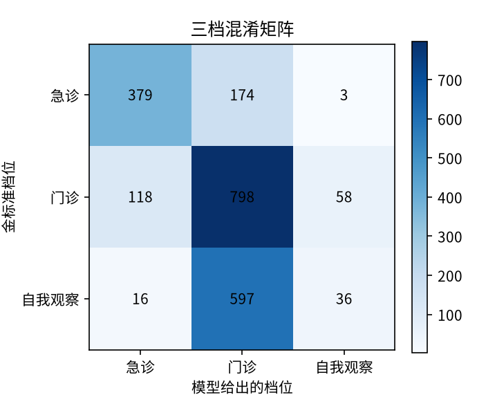

# 表述敏感性与约束机制

## 阶段一实验报告

清诉 ClearComplaint · 2026 年 12 月

---

## 摘要

大模型在健康分诊任务上对用户表述的形式高度敏感，这已经是公开的观察。本阶段要回答的是另一个问题：把这种敏感性压下去，有效的干预点在哪里。

三轮实验，21 个合成病例，八个变体条件，四个实验臂，两对异构模型，累计 7680 次真实调用。所有原始记录、语料、受控表与图都在仓库里，指标可离线重算。

三条结论。

第一，噪声决定了能看见什么。同一配置重复三次，档位一致率 0.901。低于九个百分点的效应，这个规模的样本看不见。

第二，越线的只有信息缺失。删掉病程与部位，档位一致率从 0.80 到 0.93 掉到 0.68，38 次不一致里 28 次判轻、16 次落在应当急诊的病例上。把检索依据换成无关片段，候选集合的 Jaccard 从 0.50 崩到 0.14，而且错误的依据比没有依据更糟。

第三，针对措辞的干预全部无效。错配的自我诊断、情绪、安抚性既往史、医嘱型既往史、体征同向与反向，六种条件的一致率都在 0.82 到 0.96 之间，与噪声无法区分。预设的「输入侧优于输出侧」也不成立：配对子集上 Aout 0.894 对 Ain 0.875，在两对模型上一致。

因此本阶段的有效结论只有一条：在这个任务里，干预点应该放在「缺什么就问什么」和「检索依据可靠」，而不是「怎么读用户的话」。

## 1 背景与问题

用户描述症状时会把三样东西混在一句话里：可观察的症状、自己的解释、以及情绪。医生说「我最近常常流鼻涕」，是一句主诉；用户说「我好像感冒了」，已经在做诊断。一个分诊助手要给出该不该就诊、挂什么科，它必须从这三种成分里只取第一种。

计划的出发点是一个假设：如果用户的自我诊断暗示是最强的干扰源，那么把它从输入里摘出去（降级为独立字段、不进入推理链）应该比在提示词里写「不要被用户的自我判断影响」更有效，因为后者要求模型在同一个上下文里既读进暗示又忽略暗示。

这个假设在文献里不新，所以本阶段的价值不在于「发现模型会被带偏」，而在于量化：改写造成的偏移有多大，与模型自身的随机性相比是否显著，以及不同的干预方式差多少。

## 2 方法

### 2.1 语料与病种域

引用源必须是能公开分发、逐字核验的文本。国家卫生健康委的诊疗方案属于国家机关发布的行政性质文件，可以入库；症状级指南（偏头痛、失眠、腰痛）由中华医学会各分会发布、全文在付费期刊库，既不能入库也不能公开引用。所以九个域按病种切：发热待查、呼吸道症状、腹泻呕吐、皮疹、胸痛心悸、头晕与意识改变、乏力与水肿、伤口与动物致伤、慢病随访。

54 份文件切成 1470 条片段，其中 555 条进入检索池。治疗段落（533 条，占 36%）被排除：里面是剂量与方剂，检索到就会诱发用药建议，且对「该不该就诊」没有信息量。检索用药 bge-m3 稠密向量与 2-gram BM25 的倒数排名融合，取前五条。

候选情况受 63 条受控病名约束，首诊科室受 17 个受控科室约束。两张表的每一条都能在语料里指到原文，指不到的不写入。

### 2.2 变体族

五个变体共用同一份画像（年龄段、性别、基础病、过敏史），只改说法。

| 变体 | 改什么 |
| --- | --- |
| V1 | 书面基线，含病程与部位 |
| V2 | 加一句错配的自我诊断（「我以为是过敏性鼻炎，吃了抗过敏药也没用」） |
| V3 | 加担忧情绪 |
| V4 | 删掉病程与部位，只留核心症状 |
| V5 | 拼音与错别字混写 |

第二轮又加了三组条件，各自回答一个后续问题：既往史（一致 / 冲突 / 无关）、拆开后的安抚型与医嘱型既往史、生命体征（与症状同向 / 反向）。它们不在主矩阵里，单独跑 480 到 720 格。

### 2.3 实验臂

四个臂只差五条约束的开关，检索池、JSON 输出轮廓、受控词表在四个臂里相同，它们是测量设施。

| 臂 | 打开的约束 |
| --- | --- |
| A0 | 无 |
| Aout | 输出侧提示词：四段模板锁定，明示「不要被用户的自我判断影响」 |
| Ain | 输入侧：自我归因摘成独立字段，退出推理链；口语归一化 |
| Aall | 五条全开，含红旗短路、引用闸门、澄清先行 |

### 2.4 指标与统计

主指标是同臂内各变体与 V1 的档位一致率。选择「与自身基线一致」而不是「与金标准相符」，是为了测量稳定性；与金标准相符的比例另有混淆矩阵。辅助指标是首诊科室一致率与候选集合的 Jaccard。

重复三次用来估计噪声：同一病例、同一变体、同一臂、同一模型的三次结果之间的相互一致率，就是噪声地板。

统计报按病例聚类的 bootstrap 区间（10k 次重采样，95%），不报 p 值。澄清会让一部分单元没有档位，因此主指标另给「有效率」，并用四臂都出档位的配对子集做对照，消掉澄清造成的选择偏倚。

红旗漏检的分母取金标准，不用检测结果：若用检测结果当分母，检测失败的那一格根本不进分母，指标恒为零。

### 2.5 实现与可复现

被测系统是模型加一层自研的确定性链条：归一化、红旗短路、语义检索、草稿校验、引用核验。模型先经华为云 MaaS 调用 `deepseek-v4.1-flash-1017` 与 `glm-5.2`，第三轮换到同济校园网关的 `DeepSeek-V4.1-Flash` 与 `GLM-5.3-Flash`。换平台是为了三件事：MaaS 账号两次因额度耗尽返回资源冻结、网关响应快一个量级、以及换一对模型本身构成一次跨模型复现。采样参数 `temperature=0.7`、`top_p=1.0`、`max_tokens=8192`，四个臂一致。

每次调用写一行记录，含原始响应、解析结果、检索池、开关快照、语料哈希与 token 用量。分析层只读这些记录，图由记录生成。2400 个单元里有 11 个因推理占满预算导致 JSON 截断，占 0.5%，按约定计为解析失败，不重跑。

## 3 结果

### 3.1 噪声地板

同一配置重复三次，档位一致的次数是 2005/2204，即 0.910；换成校园网关的两个模型之后是 0.901（952 对）。这意味着一次调用与另一次调用之间的差异中，有近一成与表述无关。

这个数字决定了后面的读法。四个变体与基线的档位一致率如下，只有 V4 掉出噪声范围。

| 变体 | 与 V1 的档位一致率 |
| --- | --- |
| V5 拼音错别字 | 0.92 |
| V3 情绪 | 0.88 |
| V2 自我诊断暗示 | 0.87 |
| V4 删减细节 | 0.68 |



图中每个面板是一个实验臂，格子表示两个变体给出相同档位的比例。V4 所在的行与列在裸提示词面板里明显偏浅，其余三个变体之间接近满格。

### 3.2 漂移的方向

一致率只说两个答案不同，不说哪个更危险。把不一致的单元按方向拆开，裸提示词下的 38 次不一致里，28 次判得比基线更轻，其中 16 次落在金标准为急诊的病例上。



集中在四个病例：慢阻肺患者气促加重、腹泻三天伴少尿、老年人意识改变、持续胸痛。每个病例在两个模型、三次重复里反复踩同一个坑。其余三个变体的不一致略偏保守方向，净 +3 到 +5 次。

### 3.3 干预的比较

四臂都给出合法档位的 781 个单元上：

| 臂 | 档位一致率 | 科室一致率 |
| --- | --- | --- |
| A0 裸提示词 | 0.808 | 0.750 |
| Aout 输出侧提示词 | 0.894 | 0.788 |
| Ain 输入侧归因摘除 | 0.875 | 0.788 |
| Aall 五条全开 | 0.913 | 0.827 |

三个约束臂都明显高于裸提示词，这是第一轮没有出现的分离。约束有效，但 Aout 不低于 Ain，干预点位置的主张仍然没有数据支持。

输出侧提示词在配对子集上还略好于输入侧归因摘除，两个模型的排序一致。这一条最不受欢迎：我们想主张输入侧处理更根本，数据不支持。



Aall 的数字最高，但它的有效率只有 0.71：澄清先行把 29% 的单元挡在了结论之外，被挡掉的恰好是漂移最大的 V4。配对子集这一栏才是可比的。

### 3.4 模型之间

跨变体共有 57 处偏离基线的判断，其中只有 13 处是两个模型同时发生的，44 处各自发生。逐格的漂移谈不上模型无关。但主效应是稳的：删减细节的一致率在旧模型上是 0.681，在新模型上是 0.683。要引用的是主效应，不是逐格漂移。

### 3.5 与金标准的偏差

除了稳定性，还看了结论本身对不对。



急诊与门诊两档的召回分别是 72% 与 82%。问题集中在自我观察这一档：金标准要求自我观察的 720 个单元里，模型只给出 30 次。

这个数字后来被证明来自一处测量缺陷。病例一直带着画像，金标准也在画像前提下标定，但管线从未把画像传给模型。模型面对的是匿名主诉，六十多岁有高血压的人和健康年轻人拿到同一段文本。补上画像之后，自我观察档恢复正常使用，与金标准的相符率从 0.557 升到 0.582。

这个偏移与 V4 的低判方向相反，也更影响产品可用性。「一周内复评即可」是这套输出里对用户最有价值的一档，模型几乎不用它。

### 3.6 红旗

约束链上的红旗短路是确定性的，不咨询模型。加约束的臂里，210 个命中单元全部判成急诊，误报 0，命中后无一例外。金标准要求急诊的 240 个单元中，210 个的文本含规则认得的措辞。

覆盖率从最初的 16% 提到 87.5%，走了两步：先把触发词从书面短语扩到日常说法（「烧退不下来」「一直想睡」「尿很少」），再给每条触发词加否定与假设的作用域。剩下 12.5% 多是删掉细节的变体，本来就没有可识别的信号。

这是五条约束里唯一做到零漏检的一条，也是阶段二最该原样搬走的东西。

## 4 讨论

### 4.1 为什么 V4 是唯一越线的变体

V2 加了一句明显的错误归因，一致率 0.82，落在噪声里。更直接的证据来自第三轮：把主诉凶险、体征正常的病例交给模型（V7b），金标准为急诊的 30 个单元里相符率 0.800，与基线完全一致。叙述与数值冲突时，模型按症状叙述走。

V4 去掉的是病程与部位，模型没有可以丢的干扰项，只能按剩下的信息猜。信息越少，判断越依赖先验，而这个先验的落点是门诊（见 3.5），所以相对基线的急诊判断被拉了下来。

约束链里真正在起作用的不是「怎么读用户的输入」，而是「缺什么就追问」。V4 的一致性在加了澄清先行之后表面上回到 1.00，但那是因为这一族单元被排除在比较之外，不是判得更准。

### 4.2 确定性规则的代价

红旗规则是子串匹配，不认语境。「没有胸痛」曾经命中胸痛规则，「会不会脱水」曾经命中脱水规则。加约束的臂上，132 次命中里有 18 次是这么来的。

修法是给每条触发词加一个六字的否定与假设作用域。改完之后误报从 18 降到 0，真阳性保持 114。中途掉过 6 个真阳性，原因是「尿都少了」这个真实信号没有对应的触发词，补上之后恢复。

这条可以单独作为工程结论：规则要在不咨询模型的前提下保持安全，就必须有确定性的否定作用域。它不需要语义模型，只需要一个窗口和一张否定词表。

### 4.3 约束管不到的地方

候选集合与基线的 Jaccard 均值：裸提示词 0.50、输出侧 0.48、输入侧 0.49、全开 0.49。四个臂没有差别，而且只有 0.50。同一病例换一种说法，模型给出的可能相关情况换掉一半。

五条约束管的是引用是否合法，不管选哪些情况。自由度最大的那一段输出，恰好没有约束覆盖。这也是引用闸门在 2400 个单元里几乎零删除的原因：它只核引文是否属实，管不到候选选得对不对。

### 4.4 记忆与体征都不改变结论

既往史写了三种：与证据一致、与证据冲突、与问题无关。一致率分别是 0.892、0.908、0.950，与金标准的相符率之差最大 5 个百分点，区间跨零。

冲突史这一格后来发现操纵本身有混杂：病历说「上次也这样、后来好了」，模型读到的可能不是安抚而是复发信号，而复发在临床上本身就是升级依据。数据支持这个怀疑，V6b 相对基线升 12 次、降 2 次。

拆开重测之后，纯安抚型（只有「既往体健、体检正常」）与医嘱型（「医生说过先在家观察」）都落在噪声里，后者的点估计甚至是正的。

生命体征同理：叙述凶险、体征全部正常的条件没有把任何一个急诊病例拉下来。这对产品是安全的好消息，但同向体征也没有提高相符率，说明模型对数值的利用很浅。

### 4.5 信息不足时的退路

删掉细节之后，「全科医学科」在科室输出里占到 26%，而基线是 12%。科室一致率普遍低于档位一致率，这与模型往泛化科室退有关。用户拿到「去全科」等于没拿到建议。

## 5 局限

案例集是 21 个合成病例，不是临床样本。金标准由三名工科生基于公开指南合议得出，并非临床标注。

噪声地板 0.901 本身构成检出下限。以 20 个病例、每个四次对照的规模，低于 9 个百分点的差异看不出来。这也解释了为什么既往史与体征的结论只能写成「未检出效应」，不能写成「没有效应」。

语料限于九个病种域，训练集外的症状没有覆盖。触发词表覆盖急诊文本 87.5%，这个数字相对于我们自己的病例集算出，换成真实主诉会更低。

澄清先行带来的选择偏倚用配对子集处理，代价是真实的：18% 的请求停在追问，没有结论。

第三轮之前的所有数字都受一个测量缺陷影响：画像没有进提示词。修好之后主效应复现，但第一、二轮的具体数值（噪声地板 0.910、Aall 0.942）与第三轮不可直接比较，报告里凡引用旧数字都注明了来源轮次。

两个模型的端点经过两次迁移（华为云 MaaS、同济校园网关），其间遇到过资源冻结、限流、以及一个自称 ChatGPT 的 DeepSeek 端点。模型可用性不构成结论的一部分，但材料里按网关标称记录。

## 6 结论与对阶段二的启示

本阶段证否了两个预设假设：自我诊断暗示不是最强的漂移来源，输入侧归因摘除也没有跑赢输出侧提示词。后来补做的四组条件（既往史、安抚拆解、生命体征、温度）同样是零。

留下的结论只有一条：决定分诊稳定性的是证据有多少，用户怎么说只影响很小。

删掉病程与部位，一致率掉 23 个百分点，且错误方向是判轻。换掉检索依据，候选集合崩掉八成五，且错误的依据比没有依据更糟。这两处正是产品里可以动手的地方。

对阶段二，好消息四条。红旗短路做到了 210 命中、零误报、零漏检，安全骨架可以直接搬。澄清先行有 V4 的 23 个百分点撑腰，是唯一有强证据的约束。「缺什么就问什么」与「检索依据要可靠」这两条，正好落在平台侧能控制的地方：起始工作流负责问，知识库负责答。验收阈值有了实测依据，不再是拍脑袋的数字。

不利的消息三条。创新点主张得换：原来的「输入侧优于输出侧」不成立，能讲的是「否证了三条流行假设并定位了真诱因」。科室是最弱的一环，一致率 0.75 到 0.83，信息不足时 26% 退到全科，而科室恰恰是用户最想要的那一格。自我观察档即使补上画像也只有 0.58 的相符率，说明这一档要靠随访机制补，不能指望提示词。

三条约束的命运因此分明：澄清先行与红旗短路保留并作为核心卖点；归一化保留作为输入卫生；引用闸门保留作为安全底线，但材料里不能说它提升了一致性；归因摘除降级为输入清洗的一部分，不作主张。

## 附录 复现

```bash
cd experiment
uv run python -m tools.run_matrix --cases pilot  --arms A0,Aout,Ain,Aall --reps 3 --models 2 --workers 6 --tag full
uv run python -m tools.run_matrix --cases drafts --arms A0,Aout,Ain,Aall --reps 3 --models 2 --workers 6 --tag full
uv run python -m analysis.metrics runs/*.jsonl
uv run python -m analysis.figures runs/*.jsonl
```

语料构建：`tools/ingest.py`（抽取）、`tools/fetch_govcn.py`（补齐）、`tools/chunk.py`（切片）、`tools/controlled.py`（受控表）、`tools/embed.py`（冻结向量）、`tools/build_kb.py`（导出平台知识库）。

分析层按 `unit_id` 去重，后给的文件覆盖先给的。部分变体重跑过，`runs/` 下同一单元可能有新旧两条记录。语料构建：`tools/ingest.py`（抽取）、`tools/fetch_govcn.py`（补齐）、`tools/chunk.py`（切片）、`tools/controlled.py`（受控表）、`tools/embed.py`（冻结向量）、`tools/build_kb.py`（导出平台知识库）、`tools/build_handoff.py`（生成冻结样本）。

阶段二实现依据在 `experiment/handoff/constraints.md`（五条约束的判据、变换、断言、反例），验收样本在 `experiment/handoff/frozen_sample.jsonl`（100 条，20 例 × 5 变体）。详细方法与逐项数字见 `docs/stage1.md` 与 `docs/stage1-result.md`。
