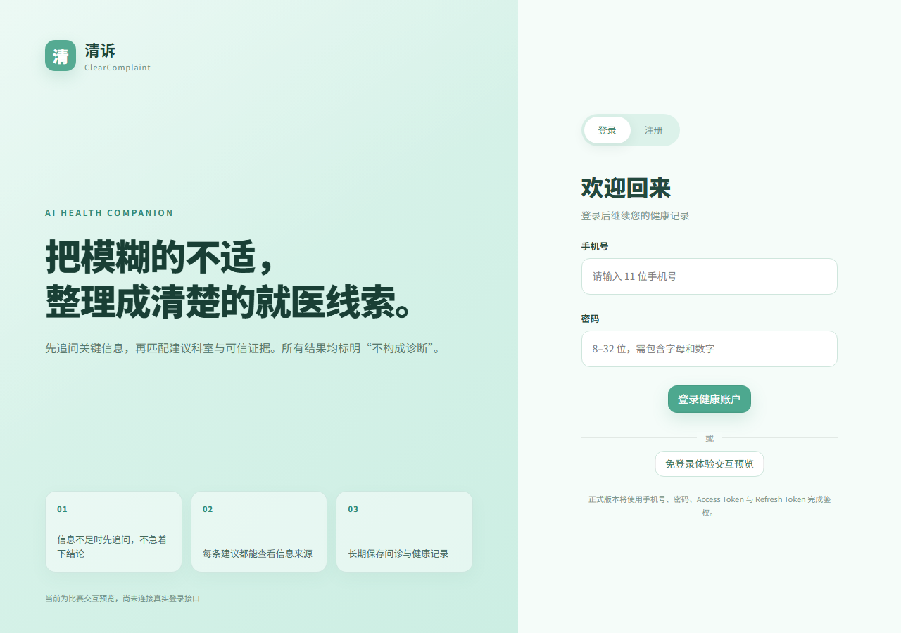
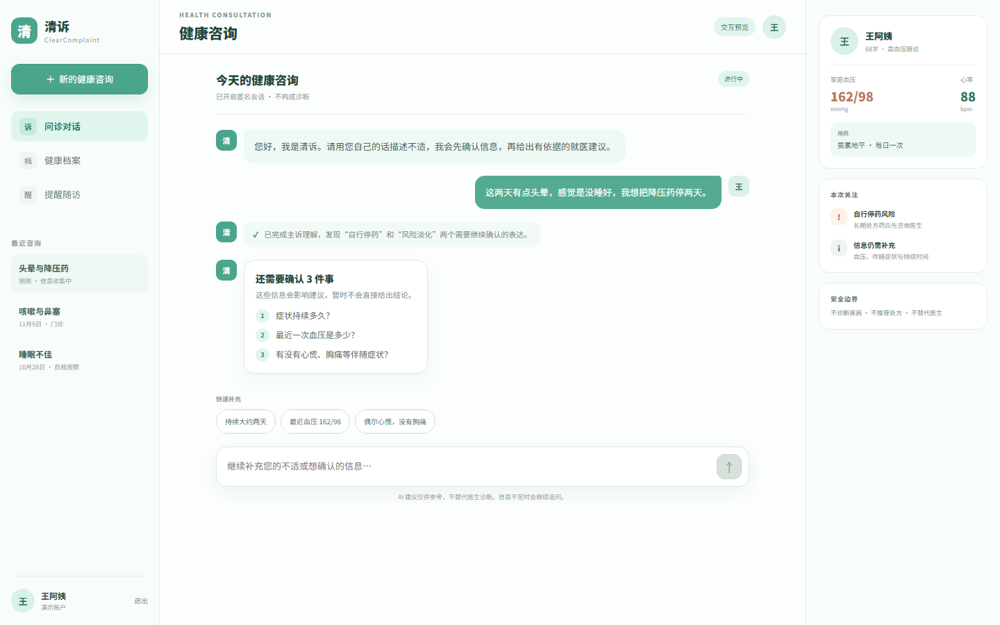
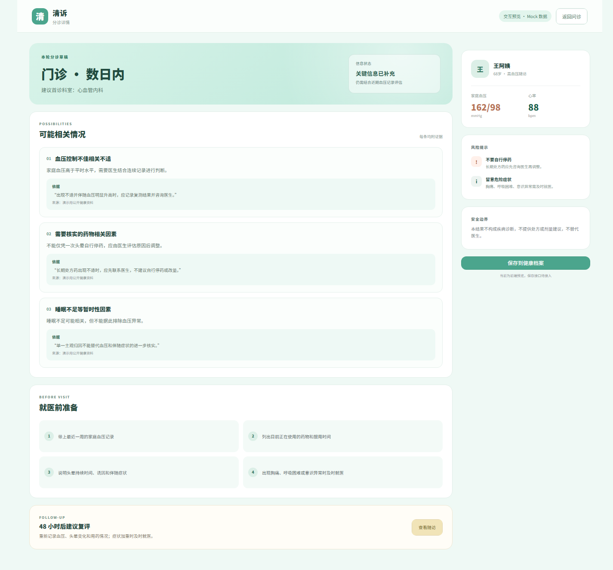

# 清诉前端预览说明

## 一、这是什么

这是目前电脑端前端的预览说明。

现在的前端分两种模式：

1. **正式模式**  
   连接 B 的 FastAPI 后端，使用真实的注册、登录、档案、问诊、保存和提醒接口。

2. **交互预览模式**  
   不需要启动后端和数据库，直接使用演示数据查看完整的页面和交互。

后端目前没有运行，所以现在最适合大家先看交互预览。

---

## 二、怎么打开看

前端代码在：

```text
frontend/
```

在项目根目录执行：

```bash
cd frontend
pnpm install
pnpm dev:h5
```

浏览器打开：

```text
http://localhost:5173
```

打开后先看到登录页，点击：

> 免登录体验交互预览

就可以进入完整的电脑端工作台。

注意：`localhost:5173` 只能在运行项目的电脑上打开，不能直接把这个地址发给别人。

---

## 三、先看截图

### 登录页



### 健康工作台



### 分诊详情



---

## 四、目前界面已经有什么

### 1. 登录和注册

- 手机号、密码登录；
- 注册并展示隐私政策入口；
- 记住登录状态；
- Token 自动刷新；
- Token 失效后返回登录页；
- 退出登录；
- 未登录不能直接进入业务页面。

### 2. 健康档案

- 姓名；
- 出生日期；
- 性别；
- 常住城市；
- 既往病史；
- 过敏史；
- 病史备注；
- 读取已有档案；
- 保存档案；
- 档案不完整时先补全，再开始问诊。

### 3. 连续问诊

- 输入主诉；
- 使用 SSE 接收 Agent 的流式处理状态；
- 在同一会话中继续追问；
- 动态显示 Agent 下发的追问；
- 支持选项按钮和自由输入；
- 提交补充信息；
- 跳过追问；
- 失败后重试；
- SSE 中断后尝试读取问诊详情并恢复。

### 4. 分诊结果

- 展示就医层级；
- 展示建议科室；
- 展示可能相关情况；
- 展示证据来源；
- 展示就医前准备；
- 查看完整分诊详情；
- 保存到健康档案。

### 5. 健康档案

- 最近血压；
- 历史问诊数量；
- 待处理提醒；
- 血压趋势；
- 历史问诊列表；
- 点击历史问诊查看详情；
- 手动录入血压；
- 查看和管理用药。

### 6. 提醒和随访

- 查看用药提醒；
- 查看复查提醒；
- 查看随访提醒；
- 用药“已服用 / 稍后提醒”；
- 复查“已就诊 / 已好转”；
- 随访“已缓解 / 未缓解 / 出现新症状”。

### 7. 数据和账户

- 导出健康数据；
- 清空健康数据；
- 注销账户；
- 高风险操作二次确认。

### 8. 交互预览模式

即使后端没有启动，也可以查看：

- 登录页；
- 工作台；
- 连续对话；
- 三步快捷追问；
- 分诊草稿；
- 健康档案；
- 提醒页面；
- 分诊详情。

预览模式中的数据都只是 Mock，不会写入真实数据库。

---

## 五、目前完成到什么程度

### 已经完成

- 电脑端整体排版；
- 登录注册、档案、工作台、结果、档案、提醒等页面；
- 前端请求封装；
- Bearer Token；
- Token 自动刷新；
- 未登录和 Token 失效处理；
- SSE 客户端；
- 问诊、档案、提醒、用药、数据管理等 API 客户端；
- 后端不可用时的 Mock 演示兜底；
- 手机端响应式适配；
- 类型检查和生产构建。

### 还没有完成

- 没有和真实的 FastAPI 后端完成最终联调；
- 没有验证真实 AgentArts 返回；
- 没有确认后端部署后的 HTTPS 地址；
- 没有使用真实测试账号跑完注册、问诊、保存全链路；
- 没有确认 Nginx 是否会缓冲 SSE。

原因是目前本机没有运行 FastAPI 和 PostgreSQL。

---

## 六、需要 B 提供什么

B 需要提供：

1. 正在运行的后端地址；
2. PostgreSQL 是否已经完成迁移；
3. 一个可用的测试账号；
4. 测试环境是否允许注册；
5. CORS 是否允许 `http://localhost:5173`；
6. 远程后端时，前端应使用的 HTTPS `/api` 地址；
7. 一组真实 SSE 返回示例；
8. 部署时是否已经关闭 Nginx 的 SSE 缓冲；
9. 一份测试患者档案、体征和提醒数据。

AgentArts Key 不需要给前端，只能放在 B 的后端环境变量里。

---

## 七、需要 A 确认什么

A 需要确认：

1. 追问问题的最终字段；
2. 每类分诊结果的结构；
3. 证据列表的展示范围；
4. 纠偏结果是否需要展示给用户；
5. 阶段一实验指标和本轮运行指标如何区分；
6. 三个 AgentArts 工作流已经部署了哪个版本；
7. 真实云端接口是否已经通过联调。

---

## 八、建议一起测试的流程

1. 打开登录页并注册或登录；
2. 检查档案是否完整；
3. 补充出生日期、性别、城市、病史和过敏史；
4. 输入主诉：  
   “这两天有点头晕，我想把降压药停两天。”
5. 查看 Agent 是否下发追问；
6. 补充持续时间、血压和伴随症状；
7. 查看分诊草稿和证据；
8. 保存问诊；
9. 检查健康档案是否出现新记录；
10. 检查提醒和随访是否创建成功。

---

## 九、现在不要误解的地方

- 页面截图和交互预览不等于真实后端已经跑通；
- “已写接口代码”不等于“服务器已经验证成功”；
- 预览模式里的病例、指标和记录都是 Mock；
- 前端不会直接调用 AgentArts；
- 前端不需要 AgentArts Key；
- OCR、运动手表和家庭共享目前属于暂缓功能。

---

## 十、怎么把预览发给队友

不要直接发本机 `localhost` 地址。

推荐流程：

1. 把前端改动提交到 GitHub 功能分支；
2. 发起 Pull Request；
3. 把本说明和截图放进 PR；
4. B 拉取分支后运行前端，或者把前端部署到测试服务器；
5. 后端启动后，再一起完成真实联调。

如果只想让 A 看排版，直接看本文件里的三张截图即可。
